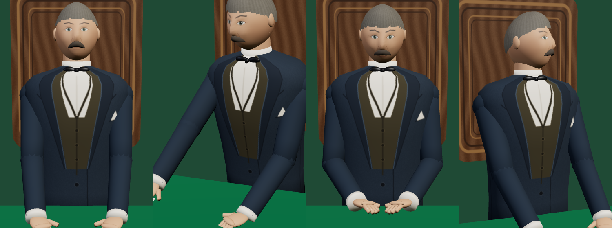

# Assets

## `dealer.glb`

A 3D version of the BlackJack / Casino dealer (grey swept-back hair, moustache, slate suit over an olive waistcoat, wing collar and bow tie, tall wooden chair back), as a single binary glTF 2.0 file (~0.8 MB, textures embedded).



- **Scale and orientation:** metres, Y up, the dealer faces +Z (towards the players), origin on the floor beneath him. Built to stand behind a table whose top is at about y = 0.95; nothing below the waist is modelled.
- **Rig:** rigid parts on named nodes (`Torso`, `Head`, `UpperArmL/R`, `ForearmL/R`, `HandL/R`, `HeldCard`, `Chair`). No skinning, so it loads in any glTF viewer or engine.
- **Animations** (play by name):

  | Name | Length | What it does | Replaces sprite |
  |---|---|---|---|
  | `Idle` | 4.0 s, loop | breathing, small head drift | `dl_idle` |
  | `Prepare` | 2.0 s | hands meet in front and square the deck | `dl_prepare` |
  | `Deal` | 1.6 s | leans in, slides a card out to the seat on his right | `dl_arrival`, `dl_mid`, `dl_return` |
  | `Look` | 2.4 s | turns his head to the side | `dl_aim`, `dl_profile` |
  | `Nod` | 1.6 s | nods down when a hand is settled | `dl_complete` |

  `HeldCard` is scaled to 0 except during `Deal`. Its world position at about 0.75 s is where to spawn the flying card.
- **Validation:** passes the Khronos glTF validator with no errors, warnings or infos.

Play it in three.js:

```js
const gltf = await new GLTFLoader().loadAsync('assets/dealer.glb');
scene.add(gltf.scene);
const mixer = new THREE.AnimationMixer(gltf.scene);
const play = (name) => mixer.clipAction(THREE.AnimationClip.findByName(gltf.animations, name)).reset().play();
play('Idle');
// each frame: mixer.update(dt)
```

`dealer-viewer.html` is a small test page with a button per animation. Serve the folder (for example `npx http-server assets`) and open it.

To rebuild it after changing proportions, colours or poses (needs `numpy` and `Pillow`):

```sh
python3 tools/make_dealer_glb.py assets/dealer.glb
```

If `assets/source/cardback.webp` exists, it is used as the back of the held card; otherwise a plain red back is drawn.

## `card.glb`

A 3D playing card (ace of spades) for the cards chat, as a single binary glTF 2.0 file.

- **Size:** standard poker card, 63.5 × 88.9 mm, 0.3 mm thick, with 3 mm rounded corners. Units are metres.
- **Orientation:** Y up, face pointing +Z, centred on the origin.
- **Materials:** `CardFront`, `CardBack` (embedded 512×1024 PNG textures) and `CardEdge` (plain off-white).
- **Validation:** passes the Khronos glTF validator with no errors, warnings or infos.


To regenerate it (needs `numpy` and `Pillow`):

```sh
python3 tools/make_card_glb.py assets/card.glb
```

To load it in three.js:

```js
new GLTFLoader().load('assets/card.glb', (gltf) => scene.add(gltf.scene));
```
