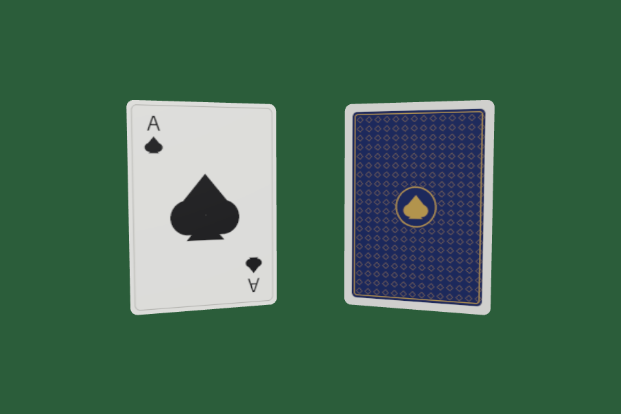

# Assets

## `card.glb`

A 3D playing card (ace of spades) for the cards chat, as a single binary glTF 2.0 file.

- **Size:** standard poker card, 63.5 × 88.9 mm, 0.3 mm thick, with 3 mm rounded corners. Units are metres.
- **Orientation:** Y up, face pointing +Z, centred on the origin.
- **Materials:** `CardFront`, `CardBack` (embedded 512×1024 PNG textures) and `CardEdge` (plain off-white).
- **Validation:** passes the Khronos glTF validator with no errors, warnings or infos.



To regenerate it (needs `numpy` and `Pillow`):

```sh
python3 tools/make_card_glb.py assets/card.glb
```

To load it in three.js:

```js
new GLTFLoader().load('assets/card.glb', (gltf) => scene.add(gltf.scene));
```
