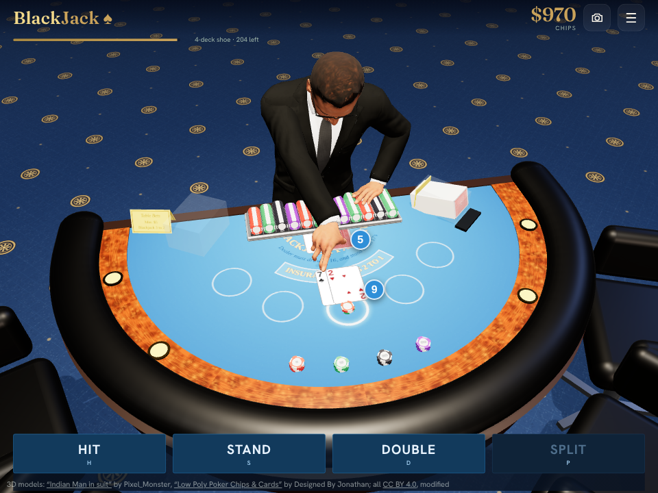

# Integrations

## `blackjack-table3d.html` (current)

Turns the BlackJack artifact into a full 3D table: casino carpet, blue felt with the printed arcs and betting circles, a leather and burl-wood rail with gold cup holders, a chip rack, an acrylic shoe, a discard holder, a limits placard and leather chairs. The dealer is the rigged character in `assets/dealer-realistic.glb` (see `assets/CREDITS.md`; the page shows the required CC BY credit). He stands behind the table, and his real arm bones are driven by two-bone IK: he deals every card with his left hand from the shoe, and his head follows the play.

How it fits into the game:
- It reads the game state (`S.hands`, `S.dealer`, `S.phase`, `S.bet`) every frame and mirrors it. Cards, chip stacks, totals and outcomes follow the game, and the rules code is untouched.
- It hides the 2D table layers by adding the `w3d` class to `#wrap`. The page needs the CSS block that goes with that class. The buttons, chip tray, banner and menu stay as they are.
- A camera button in the top bar cycles between your seat and the two side views.
- If WebGL or three.js can't load, the 2D table stays.

The table is built in code: a smooth semicircle with a padded black leather rail, polished burl-wood trim, glowing cup holders, a tilted chip rack and tufted leather chairs, on a navy carpet with small gold seals. In 3D mode the action buttons become a flat navy bar with blue keys. The chips and the card back come from `assets/chips-cards.glb`. It follows the reference video of the game it is modelled on:
- You bet by tapping the 3D chips on the felt in front of your seat (they replace the 2D chip buttons); the last chip you tapped glows.
- The dealer carries every card from the shoe to its spot with his left hand, leaning in from the hips to reach your spot.
- On your turn he points his index finger down at your cards (hit or stand?), with a light tap.
- He takes a lost bet back to the tray, brings winnings from the tray to your spot, and sweeps each hand's cards into the discard holder.
- Cards are unlit and pure white, fanned in a row with large corner indices, with round total badges and WON / LOST / BUST tags.
- The table is sized so the dealer can reach your spot.

To install it, paste the snippet before `</body>` and publish `dealer-model.js` and `chips-model.js` next to the page (each is `export default "<base64 of the .glb>";`). That file is `export default "<base64 of assets/dealer-realistic.glb>";`; it is a script because artifacts don't serve `.glb` files.

The camera button cycles through four views: high over the felt so the cards read from above (the default), your seat, and the two side seats.

## `blackjack-dealer3d.html` (earlier, superseded)

The snippet that puts `assets/dealer.glb` into the BlackJack artifact in place of the dealer sprite. Paste it just before `</body>`, then replace `__GLB__` with the base64 of `assets/dealer.glb`.

What it does:
- Renders the 3D dealer, head and body, inside the existing `#bjDealer` portrait box, with the same framing as the sprite. The model's own arms are hidden because the game's 2D arms deal the cards.
- Plays `Idle` all the time. While a card is being dealt, his head follows the dealing hand. When a hand settles, he plays `Nod`.
- If WebGL or three.js can't load, the original sprite stays.

The game's `bjDealerPose()` also needs two changes: it keeps the `d3` class and calls `window.__d3pose(name, ms)`. That way the existing `dl_aim` and `dl_complete` calls drive the 3D dealer.
